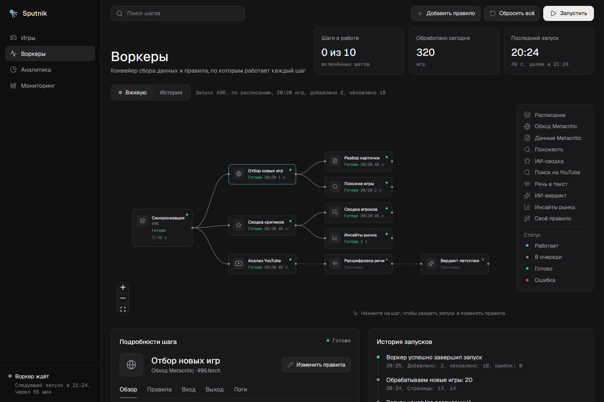
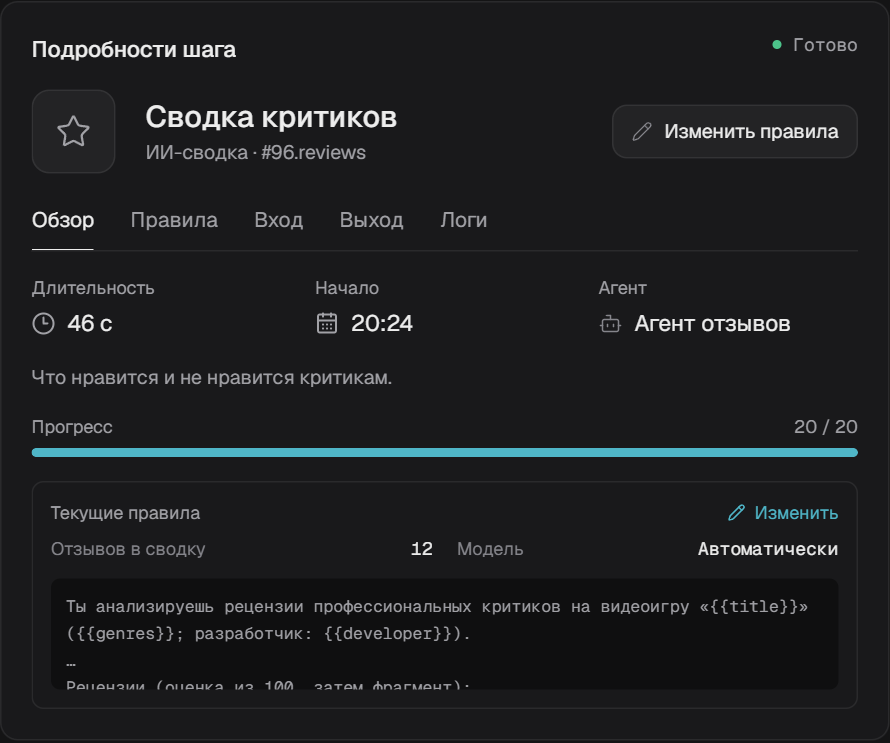
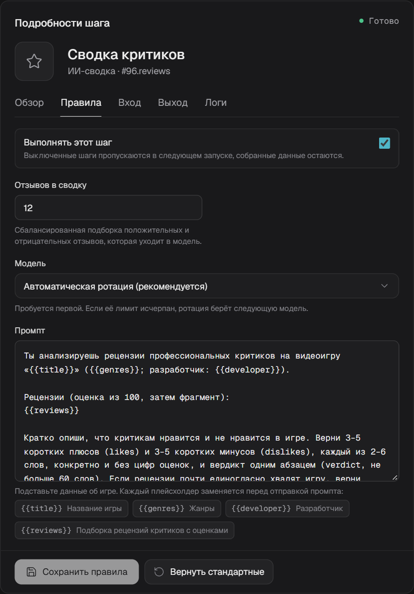
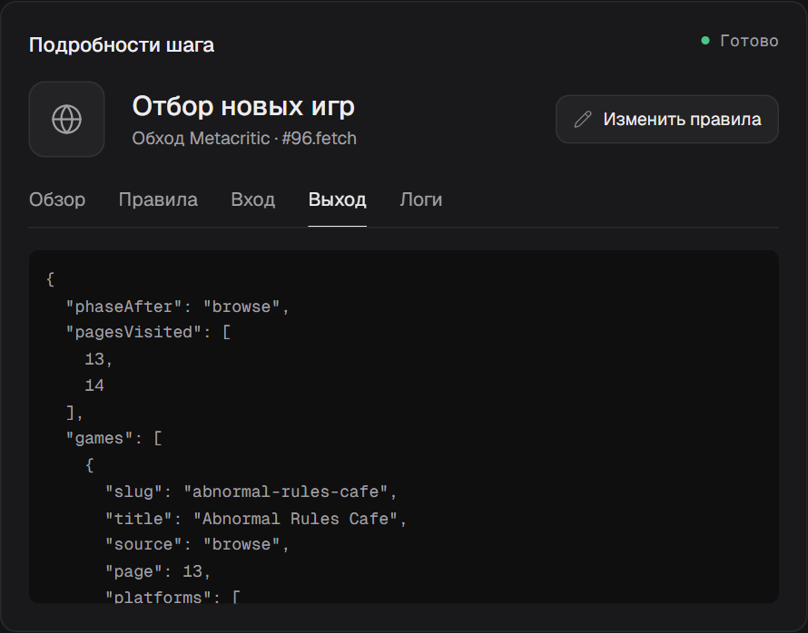
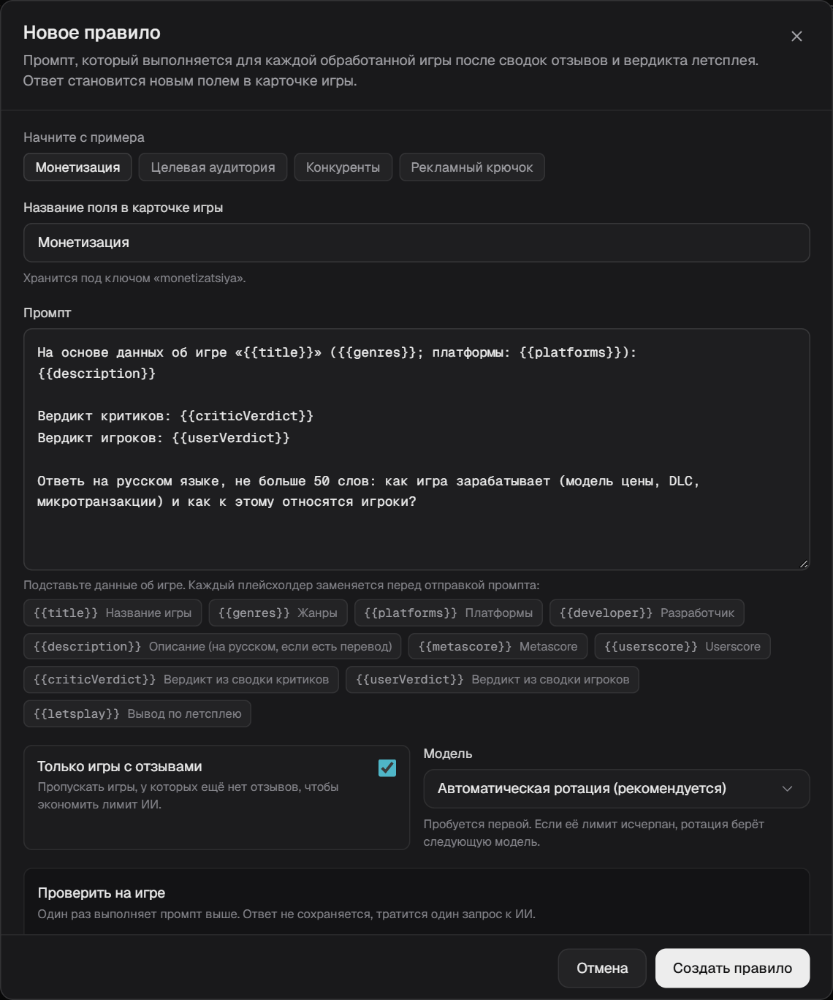
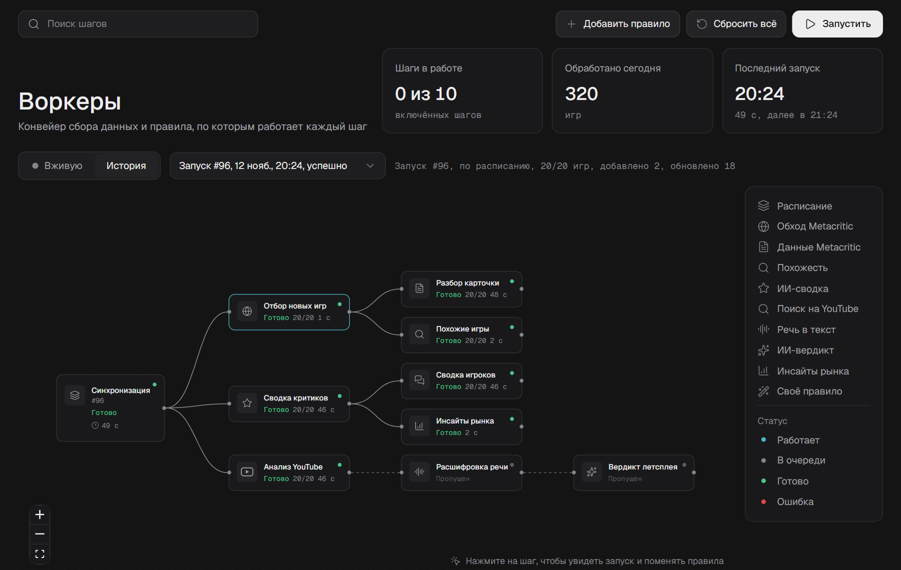
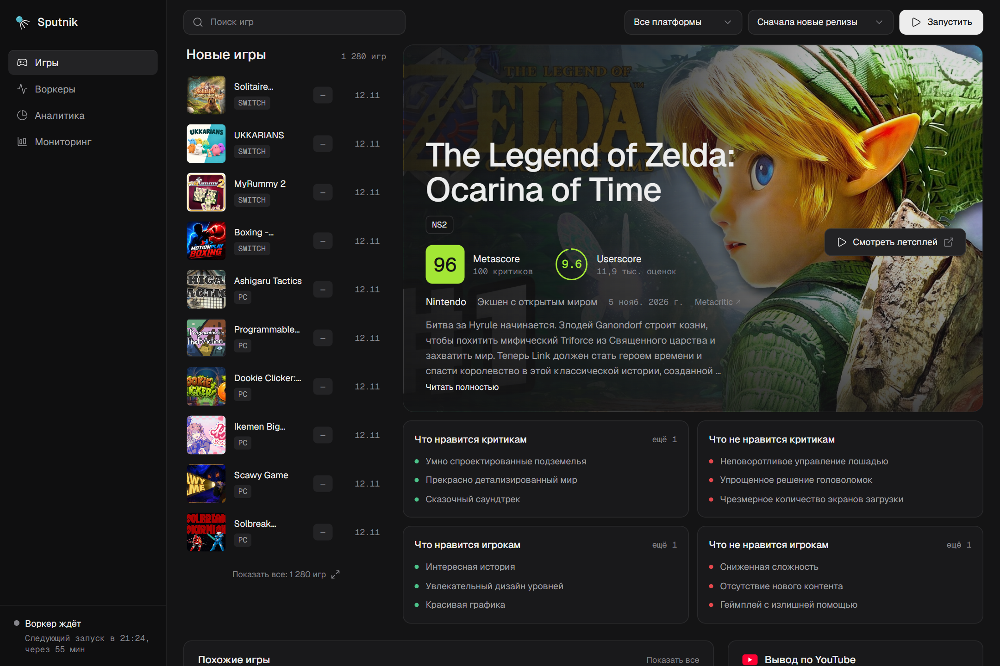
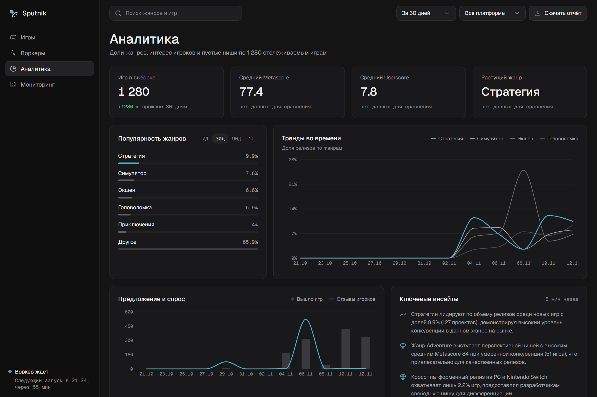
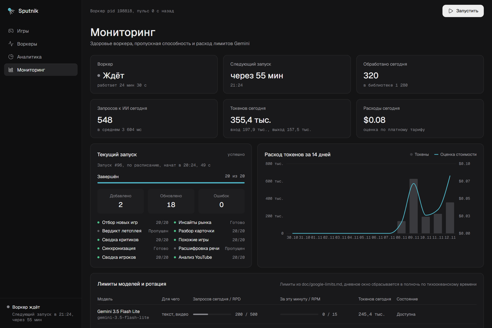

<div align="center">


# Sputnik

**ИИ-радар игрового рынка.** Каждый час забирает новые игры с Metacritic, читает за вас рецензии критиков и отзывы игроков, смотрит самый популярный летсплей на YouTube и показывает, что рынок думает о каждой игре и где пустые ниши.

[**Открыть демо →**](https://sputnik.morozfedor.dev)

</div>



## Что вы получаете

- **Карточку каждой новой игры**: оценки Metascore и Userscore по платформам, описание на русском, трейлер.
- **Выжимку отзывов за 10 секунд.** ИИ раскладывает рецензии на «что нравится» и «что не нравится» отдельно для критиков и для игроков.
- **Мнение блогера.** Воркер сам находит самый просматриваемый летсплей с комментариями, расшифровывает речь и пишет вывод со ссылкой на видео.
- **Аналитику для гейм-дизайнера и закупщика трафика**: растущие жанры, предложение и спрос, недооценённые ниши, ключевые инсайты.
- **Полный контроль над ИИ без кода.** Об этом вкладка «Воркеры» ниже.

## Вкладка «Воркеры»: ИИ-конвейер, который видно и которым можно управлять

Обычно сбор данных с ИИ — чёрный ящик: что-то крутится на сервере, а почему ответ получился именно таким, не понять. В Sputnik весь конвейер на виду. Каждый шаг — это блок на графе. Видно, что он делает прямо сейчас, что получил на вход, что выдал и по каким правилам работает. Правила меняются мышкой, и следующий запуск сразу идёт по ним.

### 1. Смотрите на работу вживую

Откройте **Воркеры**. На графе весь путь игры: синхронизация с Metacritic → отбор новых игр → разбор карточки → сводки критиков и игроков → поиск летсплея → расшифровка речи → вердикт блогера → похожие игры и инсайты рынка.

Во время запуска каждый блок показывает статус («В очереди», «Работает», «Готово», «Ошибка»), таймер и прогресс по играм. Страницу обновлять не нужно. Сверху — сколько шагов работает сейчас, сколько игр обработано за день и когда следующий запуск.

### 2. Нажмите на шаг — увидите всё о нём



Под графом откроются **Подробности шага**: сколько он работал в последнем запуске, когда начал, какой агент его выполняет и с какими правилами.

### 3. Меняйте правила без кода



1. Нажмите **Изменить правила** (или вкладку **Правила**).
2. Поменяйте что нужно. У каждого параметра есть подсказка: сколько игр брать за запуск, как часто запускаться, сколько отзывов отдавать модели, какой длины фрагмент видео расшифровывать, какой дневной лимит видео.
3. Выберите модель или оставьте автоматическую ротацию: если у модели кончился лимит, Sputnik сам переключится на следующую.
4. Отредактируйте промпт. Данные об игре подставляются кликом по плейсхолдеру: `{{title}}`, `{{genres}}`, `{{reviews}}` и другие.
5. Нажмите **Сохранить правила**. Следующий запуск пойдёт по новым правилам.

Ненужный шаг можно выключить переключателем «Выполнять этот шаг». Неверное значение не сохранится: под формой появится понятная ошибка. **Вернуть стандартные** откатывает шаг к правилам из ТЗ, **Сбросить всё** — весь конвейер.

### 4. Загляните внутрь: вход, выход, логи



Вкладки **Вход** и **Выход** показывают, что шаг получил и что отдал в последнем запуске: отобранные игры, промпт, который ушёл в модель, и её ответ. **Логи** — построчный журнал шага. Если ответ ИИ кажется странным, причину видно сразу.

### 5. Добавьте своё правило — получите новое поле в карточке каждой игры



1. Нажмите **Добавить правило**.
2. Начните с примера («Монетизация», «Целевая аудитория», «Конкуренты», «Рекламный крючок») или напишите свой вопрос.
3. Кликами вставьте данные об игре: описание, вердикты критиков и игроков, вывод по летсплею.
4. Нажмите **Проверить** и посмотрите ответ на любой игре из библиотеки. Ничего не сохраняется.
5. Нажмите **Создать правило**. Новый блок появится на графе, а ответ — в карточке каждой обработанной игры.

### 6. Вернитесь к любому прошлому запуску



Переключитесь с **Вживую** на **История** и выберите запуск. Граф покажет, как тогда отработал каждый шаг, а справа будет лента событий запуска.

## Остальные вкладки

**Игры** — список новинок с поиском, фильтром по платформе и сортировкой, карточка игры, похожие игры, вывод по YouTube и монитор сервиса.



**Аналитика** — доли жанров и тренды, предложение и спрос, недооценённые ниши, популярные сочетания жанра и платформы, топ игр по интересу игроков и ключевые инсайты от ИИ. Отчёт выгружается в CSV.



**Мониторинг** — здоровье воркера, текущий запуск, расход токенов и оценка стоимости, лимиты каждой модели, ошибки и история запусков.



## Запустить у себя

Нужны Node.js 24 и pnpm.

```sh
pnpm install
```

Создайте `.env` в корне проекта:

```dotenv
GOOGLE-AI-KEY=...        # ключ Google AI Studio (обязательно)
OPENAI_API_KEY=...       # необязательно: запасной вариант для текста и эмбеддингов
GEMINI_BASE_URL=...      # необязательно, например https://gateway.ai.cloudflare.com/v1/<account>/<gateway>/google-ai-studio/v1beta
CF_AIG_TOKEN=...         # необязательно: токен для Cloudflare AI Gateway с авторизацией
```

```sh
pnpm dev            # интерфейс на http://localhost:3000 и воркер вместе
pnpm dev:web        # только интерфейс
pnpm worker         # только воркер (расписание, кнопка «Запустить», пульс)
pnpm worker:once    # один запуск сбора и выход
```

Нажмите **Запустить** — через пару минут появятся первые 20 игр.

Данные лежат в SQLite в `data/sputnik.db`, путь меняется переменной `SPUTNIK_DATA_DIR`. Миграции из `drizzle/` применяются сами при старте.

Если Google отвечает `User location is not supported for the API use`, Gemini API не работает в регионе сервера. Пустите запросы через [Cloudflare AI Gateway](https://developers.cloudflare.com/ai-gateway/): задайте `GEMINI_BASE_URL` (и `CF_AIG_TOKEN`, если шлюз с авторизацией). Ключи читаются только на сервере и вырезаются из логов, в браузер они не попадают.

## Как это устроено

1. **Отбор.** Первый запуск дня (по `Europe/Moscow`) берёт блок *New Releases* на Metacritic. Следующие листают *See All → Newest* и пропускают игры, уже обработанные сегодня. На следующий день всё начинается заново.
2. **Каждая игра.** Воркер читает данные Metacritic и оценки по платформам, переводит описание на русский, делает сводки по сбалансированной выборке положительных и отрицательных отзывов, находит летсплей, расшифровывает 3 минуты речи Gemini прямо по ссылке YouTube и пишет вывод. Затем строит эмбеддинг для поиска похожих игр.
3. **После запуска.** Обновляются списки похожих игр и пишутся инсайты для аналитики.

Расписание отсчитывается от старта предыдущего запуска: запуск в 01:23, который длился 48 секунд, сменит следующий в 02:23.

**Ротация моделей.** Запросы распределяются по моделям Gemini с учётом бесплатных лимитов из [`doc/google-limits.md`](doc/google-limits.md): сначала Flash Lite (500 запросов в день каждая), затем Gemma 4 для текста, затем Flash (20 в день). Счётчики хранятся в SQLite и переживают перезапуск. Модель, ответившая 429 или 503, ставится на паузу, и запрос уходит следующей. OpenAI подключается последним и только при наличии `OPENAI_API_KEY`.

Требования и решения описаны в [`openspec/`](openspec/), исходное ТЗ — в [`doc/TZ.md`](doc/TZ.md).

## Проверки и скрипты

```sh
pnpm check                                              # типы, eslint и тесты vitest
node scripts/ui-smoke.mjs http://localhost:3000 /tmp    # браузерная проверка: правит правило и нажимает «Запустить»
node scripts/readme-shots.mjs <url> doc/readme          # скриншоты для этого README, только чтение
pnpm tsx scripts/translate-db.ts --dry-run              # сколько данных в базе ещё на английском
```

`scripts/ui-smoke.mjs` запускает настоящий сбор: он ходит на Metacritic и тратит лимит Gemini, а изменённое правило возвращает в конце. `scripts/translate-db.ts` без `--dry-run` переводит на русский то, что уже лежит в базе: описания, сводки, выводы по летсплеям, свои поля и правила. Он работает только на моделях Flash Lite, описания отправляет пачками (около 200 запросов на тысячу игр), и его можно прервать и запустить снова. Перед запуском сделайте бэкап базы.

## Безопасность

Это инструмент для одного пользователя, входа по паролю нет. Запускайте его на доверенной машине или за своей авторизацией.

`src/proxy.ts` пропускает API-запросы только с Host `localhost`, `127.0.0.1` или из списка `SPUTNIK_ALLOWED_HOSTS` (через запятую). Это защищает от DNS rebinding. Межсайтовые изменяющие запросы (запуск, правка правил) отклоняются. Ячейки CSV экранируются от формульных инъекций.

Живой статус приходит в браузер через Server-Sent Events (`/api/stream`). Если обратный прокси сжимает этот поток, он буферизует события: интерфейс переключится на опрос `/api/status`, но поток лучше исключить из сжатия. Для Caddy:

```caddyfile
@notStream not path /api/stream
encode @notStream zstd gzip
```
